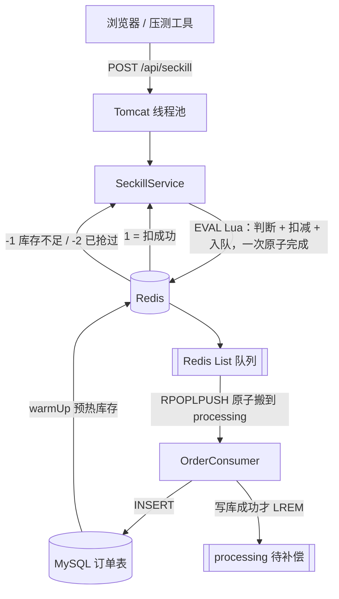

# 秒杀系统（Seckill）

1000 人抢 100 件商品，**不超卖**。用 Redis + Lua 原子扣减挡住 900 个请求，消息队列削峰，MySQL 异步落单。

## 30 秒速览（写给以后忘掉这项目的自己）

**这是什么**：一个能跑的秒杀 demo。点一下「立即抢购」= 一个用户抢一件；连点/并发进来也不会把库存抢成负数。

**怎么看到效果**（3 步）：
1. 双击 `scripts\start-redis.bat`，再双击 `scripts\start-mysql.bat`
2. 启动应用 `java -jar target\seckill-1.0.0.jar`
3. 打开 http://127.0.0.1:8081/ → 点「预热库存」→ 点「立即抢购」；想一次抢空就双击 `scripts\combo.bat`

**核心卖点一句话**：把「判断库存 + 用户去重 + 扣减 + 入队」写进一个 Redis Lua 脚本原子执行，所以并发下不可能超卖。

**最该看的 5 个文件**：

| 文件 | 看它干什么 |
|---|---|
| `src/main/resources/lua/seckill.lua` | 核心：原子扣减脚本（20 行，先看这个） |
| `src/main/java/com/seckill/service/SeckillService.java` | 怎么调 Lua、怎么预热库存 |
| `src/main/java/com/seckill/consumer/OrderConsumer.java` | 异步下单消费者（含丢单防护） |
| `src/main/resources/static/index.html` | 演示页 |
| `docs/简历与面试.md` | 简历怎么写、面试怎么答 |

**忘光了怎么办**：跑 `java -jar target/seckill-1.0.0.jar --run-test`，10 秒内自动跑一遍「1000 抢 100」和「同一用户抢 10 次」，用结果回答「这项目到底证明了什么」。

## 它解决什么问题

秒杀最经典的 bug：**超卖**。

朴素写法「查库存 → 判断够不够 → 扣库存」是三步，中间有缝。两个请求 A、B 同时进来：

```
A 查 → 看到剩 1 件
B 查 → 也看到剩 1 件（A 还没扣）
A 扣 → 剩 0
B 扣 → 剩 -1      ← 超卖
```

本项目把「判断 + 扣减」打包进一个 Lua 脚本，在 Redis 里**原子执行**，中间钻不进任何请求。

## 架构



## 核心：Lua 原子扣减

```lua
-- KEYS[1]=库存key  KEYS[2]=已抢用户集合  KEYS[3]=下单队列  ARGV[1]=用户id
local stock = tonumber(redis.call('GET', KEYS[1]))
if stock == nil or stock <= 0 then return -1 end        -- 没货

local exists = redis.call('SISMEMBER', KEYS[2], ARGV[1])
if exists == 1 then return -2 end                       -- 抢过了

redis.call('DECR', KEYS[1])                             -- 判 + 扣 + 记 + 入队
redis.call('SADD', KEYS[2], ARGV[1])
redis.call('LPUSH', KEYS[3], ARGV[1])
return 1
```

## 可靠性：两个容易漏的丢单窗口

入门版秒杀跑通了不代表不丢单。这里补掉了两个：

| 窗口 | 后果 | 做法 |
|---|---|---|
| Lua 扣成功 → Java 里再 `leftPush` 之间进程崩 | 库存扣了、消息没入队，**订单永远不生成** | 把 `LPUSH` 写进 Lua 脚本，同一段原子执行 |
| 消费者 `rightPop` 出来 → 写库前崩 | 消息已离队，**订单静默丢失**，还查不到 | `RPOPLPUSH` 先搬到 processing 列表，写库成功才 `LREM`；失败留原地可补偿 |

另外把消费者里 `catch (Exception e) {}` 的空吞改成分类处理：唯一键冲突（重复消费）直接摘掉，其它异常打日志、消息保留。

## 实测数据（本机压测）

| 场景 | 结果 |
|---|---|
| 1000 个不同用户抢 100 件 | 成功 **100**、库存 **0**、订单 **100**、超卖 **0** |
| 同一用户连抢 10 次 | 只成功 **1** 次（Redis 去重生效） |
| HTTP 压测 QPS（200 并发，1000 请求） | **733.1** |
| 请求异常 | **0** |

> 压测环境：i5-12500H / 16GB 单机，压测客户端与被测服务跑在同一个 JVM。
> 客户端和 Tomcat 线程抢同一批 CPU 核，QPS 是保守值；生产环境独立压测机 + 多实例会高一个量级。
> 这个项目的重点是「超卖 0 + 链路正确 + 可复现」，不是刷数字。

## 技术栈

Java 21 · Spring Boot 3.3 · MySQL 8.4 · Redis 5（Lua）· Tomcat

## 如何运行

```text
0. 配置数据库密码（只需一次，仓库里不含密码）：
   copy src\main\resources\application-local.example.yml src\main\resources\application-local.yml
   然后编辑 application-local.yml 填上你的 MySQL 账号密码
   （也可以不改文件，改用环境变量 DB_USERNAME / DB_PASSWORD）

1. 双击 scripts/start-redis.bat        （起 Redis，窗口里出现 PONG）
2. 双击 scripts/start-mysql.bat        （起 MySQL，弹 UAC 点"是"）
3. 双击 scripts/init-db.bat            （建库建表，输一次 MySQL root 密码）
4. 构建：mvn clean package -DskipTests
   （要用阿里云镜像：先 copy settings.example.xml settings.xml，再加 -s settings.xml）
5. 启动：java -jar target/seckill-1.0.0.jar
6. 打开 http://127.0.0.1:8081/        （点「预热库存」再点「立即抢购」）
```

> 仓库里**不含**数据库密码、也不含本机 Maven 仓库路径：它们分别放在被忽略的
> `application-local.yml` 和 `settings.xml` 里，模板是各自的 `.example` 版本。

## 连击脚本

```text
双击 scripts\combo.bat                 # 连击 99 下
scripts\combo.bat -Count 100            # 连击 100 下（直接售罄，页面自动弹窗）
scripts\combo.bat -Count 20 -DelayMs 300  # 慢速连击，能看清库存一格格掉
```

## 压测与验证

```text
# 并发验证（1000 抢 100 + 同一用户重复抢）
java -jar target/seckill-1.0.0.jar --run-test

# HTTP 压测（看 QPS）
java -jar target/seckill-1.0.0.jar --loadtest
```

## 面试可以这么讲

1. **为什么用 Redis + Lua**：数据库行锁能防超卖但 1000 请求串行排队撑爆连接池；synchronized 多实例失效。Redis 单线程 + Lua 原子脚本，把「判断+扣减」做成一步。
2. **为什么预热**：1000 个请求每个都查 MySQL 会打爆数据库；开抢前把库存搬进内存，抢购全程不碰 MySQL。
3. **为什么消息队列**：扣成功后不直接写库，丢进队列削峰；订单表唯一键保证重复消费不会重复下单（幂等）。
4. **为什么 Redis 层去重**：只靠 MySQL 唯一键，Redis 库存会被同一个人重复扣（虚扣），两边对不上。
5. **QPS 733 怎么解释**：本机压测、客户端与服务同 JVM、CPU 抢核；生产环境独立压测机 + 多实例会高一个量级。
6. **扣完库存但消息丢了怎么办**：入队写在 Lua 里，和扣减同一段原子执行，不存在这个窗口。
7. **消费者取到消息后崩了怎么办**：`RPOPLPUSH` 先搬进 processing 列表，写库成功才移除；失败的消息留在 processing 里可补偿，不会静默消失。
